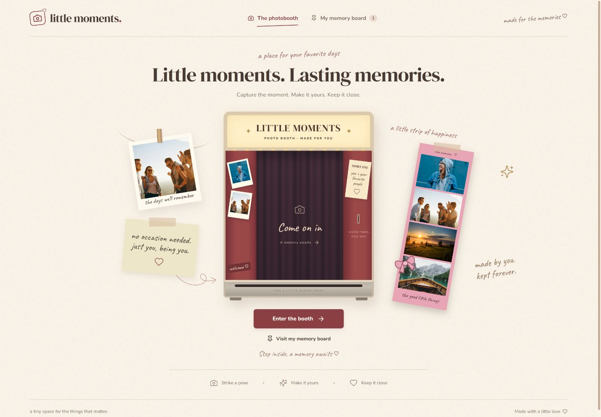
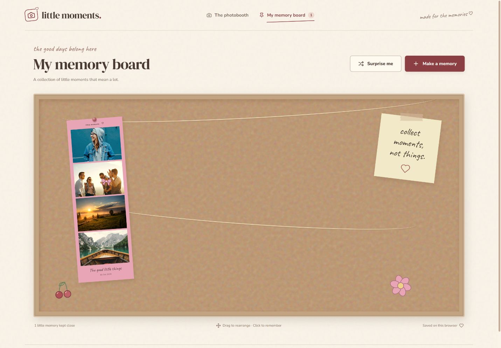

# Little Moments

A nostalgic virtual photobooth where you can capture or upload photos, decorate a keepsake, and pin it to your own memory board.

**Capture the moment. Make it yours. Keep it close.**



## Features

- **Four photo layouts:** classic four-photo strip, 2×2 grid, two-photo strip, and single Polaroid.
- **Capture or upload:** webcam countdown, retakes, photo replacement, and sample photos for exploring the app.
- **Make it personal:** six frame colors, five filters, movable stickers, caption styles, and an optional date.
- **Keep a copy:** PNG exports use the same rendering component as the live preview.
- **Your memory board:** pin keepsakes, rearrange them, add handwritten notes, reopen memories, and revisit one at random.
- **Browser-local storage:** saved photos, customizations, notes, and positions persist in IndexedDB.
- **Responsive experience:** mobile layouts, keyboard controls, and reduced-motion support.



## Technology

React · Vite · Tailwind CSS · Lucide React · html-to-image · IndexedDB

The application has no backend or authentication.

## Run locally

```sh
npm install
npm run dev
```

Open the Local URL printed by Vite. Use `npm test` for persistence tests and `npm run build` for production output in `dist/`.

## Make a memory

Enter the booth, select one of four layouts, then upload photos or enable your camera. Add frame colors, filters, captions, a date, and movable stickers. Download your PNG or pin it to the memory board. Click a saved memory to write a note, download it, change its position, or confirm its removal. The board also supports dragging and Surprise Me.

Memories are saved in IndexedDB on the current browser and origin. Pinned memories survive a reload; unfinished drafts are not persisted. Clearing site data removes saved memories. Another browser, device, hostname, or port has separate storage. Download keepsakes you want to keep elsewhere. No photo data is sent to a server. Webcam use requires localhost or HTTPS and browser permission.

## Design references

All seven supplied references were inspected before coding. Their visual language informs the physical booth, selectable templates, outlined controls, editor, corkboard, sticker art, and string/clip decorations. Reference screenshots are not displayed in the application.

## Assets

Decorative and explicitly labeled sample photos come from Unsplash and are served locally:
- https://images.unsplash.com/photo-1517841905240-472988babdf9
- https://images.unsplash.com/photo-1511988617509-a57c8a288659
- https://images.unsplash.com/photo-1470252649378-9c29740c9fa8
- https://images.unsplash.com/photo-1476514525535-07fb3b4ae5f1

DM Serif Display, Nunito, and Caveat are bundled from Google Fonts. Decorative stickers are authored SVG components. The booth, curtains, paper frames, tape, clips, and pins use CSS.

## Verification

Production build and IndexedDB save/read/update/delete tests passed. Browser checks verified entrance navigation, classic template, sample photos, frame/filter/caption/sticker updates, PNG download, board pinning, saved notes, refresh persistence, and Surprise Me. The downloaded PNG was opened and visually inspected. Entrance layouts were inspected at 1440 and 390 CSS pixels. Native file upload and physical webcam hardware were not fully exercised by automation; camera permission errors have an upload fallback.
